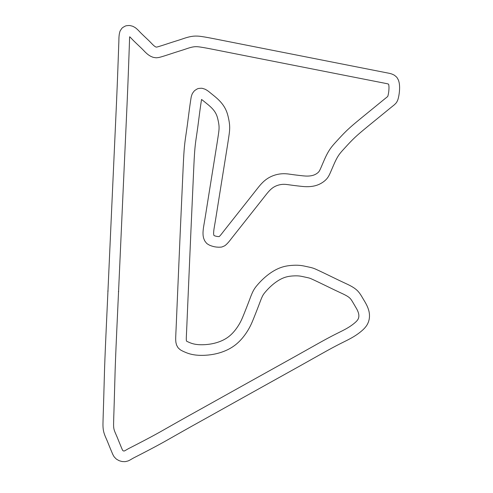
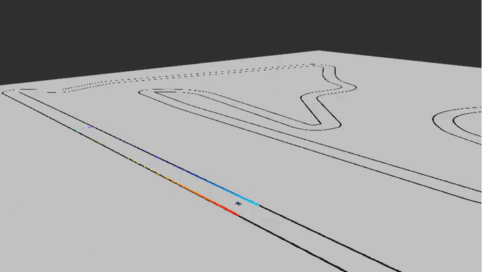

# F1Tenth - Reactive Follow the Gap Controller

**Author:** Alain Sánchez | Mechatronics Engineering Student at ESPOL  
*Project developed for the Unmanned Vehicles course.*

This repository contains a high-performance Reactive Follow the Gap controller for the F1Tenth ROS 2 simulator. The node has been highly optimized to reach top speeds (up to 11 m/s) on the Sakhir track while maintaining structural stability and preventing understeer in tight corners.

## 1. Custom Map Setup (Sakhir Track)

To run this controller on a custom track like Sakhir, you need to configure the map files in your simulator workspace. Follow these steps:

1. Extract the downloaded `.rar` or `.zip` file containing the track data.
2. Locate the map files: usually a `.yaml` file and an image file (`.png` or `.pgm`).
3. Move these files into your simulator's map directory (e.g., `src/f1tenth_gym_ros/maps/`).
4. Update the simulator's configuration file (usually `sim.yaml` inside the `config` folder) or the main launch file so the `map_path` parameter points to your new `sakhir` map.
5. Save the changes and rebuild your workspace using `colcon build`.



## 2. Running the Simulator

Open a new terminal, source your workspace, and launch the F1Tenth simulator:

```bash
cd ~/F1Tenth-Repository
source install/setup.bash
ros2 launch f1tenth_gym_ros gym_bridge_launch.py
```
*(Note: Adjust the launch command if your specific simulator repository uses a different launch file name).*

## 3. Running the Reactive Controller

Once the simulator and RViz are running, open a second terminal to execute the Follow the Gap node:

```bash
cd ~/F1Tenth-Repository
source install/setup.bash
ros2 run gap_follow reactive_node
```

## 4. Code Logic and Algorithm Explanation

The `reactive_node.py` relies on an advanced implementation of the Follow the Gap algorithm. Below is a step-by-step breakdown of the node's logic:

### 4.1. Node Initialization
```python
class ReactiveFollowGap(Node):
    def __init__(self):
        super().__init__('reactive_node')
        self.subscription = self.create_subscription(LaserScan, '/scan', self.lidar_callback, 10)
        self.publisher = self.create_publisher(AckermannDriveStamped, '/drive', 10)
```
We initialize the ROS 2 node, subscribing to the `/scan` topic to receive real-time LiDAR data, and creating a publisher for the `/drive` topic to send the Ackermann steering and speed commands.

### 4.2. LiDAR Preprocessing
```python
    def preprocess_lidar(self, ranges, angle_min, angle_inc):
        proc_ranges = np.array(ranges)
        # Vision set to 18.0m: Ideal balance between anticipation and stability
        proc_ranges = np.nan_to_num(proc_ranges, nan=18.0, posinf=18.0, neginf=0.0)
        proc_ranges = np.clip(proc_ranges, 0.0, 18.0)
        
        # Frontal cone
        angles = angle_min + np.arange(len(proc_ranges)) * angle_inc
        blind_spots = np.where(np.abs(angles) > 1.30)[0]
        proc_ranges[blind_spots] = 0.0 
        
        return proc_ranges
```
The raw laser scan data is cleaned by replacing `NaN` and infinite values with a maximum vision distance of `18.0` meters. A frontal vision cone is established by ignoring angles greater than `1.30` radians, preventing the car from erratic steering caused by parallel side walls.

### 4.3. Safety Bubble
```python
        valid_ranges = np.where(ranges > 0.0, ranges, 18.0) 
        closest_idx = np.argmin(valid_ranges)

        bubble_radius = 70
        start_idx = max(0, closest_idx - bubble_radius)
        end_idx = min(len(ranges), closest_idx + bubble_radius)
        ranges[start_idx:end_idx] = 0.0
```
The algorithm identifies the closest obstacle in the LiDAR array. It then creates a "safety bubble" around this point (with a radius of `70` array indices) by setting all distances within this bubble to `0.0`. This forces the car to avoid paths that pass dangerously close to walls or corners.

### 4.4. Finding the Max Gap and Target Point
```python
        non_zeros = np.where(ranges > 0.0)[0]
        if len(non_zeros) == 0:
            return

        gaps = np.split(non_zeros, np.where(np.diff(non_zeros) != 1)[0] + 1)
        max_gap = max(gaps, key=len)

        # Search for the target
        center_idx = max_gap[len(max_gap) // 2]
        deepest_idx = max_gap[np.argmax(ranges[max_gap])]
        best_idx = int((center_idx + deepest_idx) / 2)

        target_distance = data.ranges[best_idx]
        angle = data.angle_min + (best_idx * data.angle_increment)
```
The code splits the non-zero ranges to find all available free spaces, and selects the largest continuous sequence of valid distances. To eliminate the "snake effect" (wobbling), the target point (`best_idx`) is calculated by averaging the geometric center of the gap and the deepest point within that gap. This pulls the car smoothly forward.

### 4.5. Steering Deadband and Dynamic Velocity Profile
```python
        # Dead zone to stabilize straights
        if abs(angle) < math.radians(4):
            angle = 0.0

        # Velocity thresholds optimized for early braking
        if target_distance > 12.0 and abs(angle) == 0.0:
            velocity = 11.0  
        elif target_distance > 8.5 and abs(angle) < math.radians(8):
            velocity = 7.5   
        elif target_distance > 5.5 and abs(angle) < math.radians(20):
            velocity = 5.5   
        elif abs(angle) < math.radians(35):
            velocity = 4.5   
        else:
            velocity = 3.0   
```
If the calculated steering angle is less than 4 degrees, the node forces the angle to `0.0`. This strict deadband is crucial for maintaining a perfectly straight trajectory on long straights. The controller then uses predictive braking based on `target_distance` and steering `angle`. It reaches `11.0 m/s` on long straights, but drops to `7.5 m/s` and `5.5 m/s` early enough to reduce momentum before sharp corners, effectively preventing understeer.

### 4.6. Publishing the Command
```python
        # Publish command
        drive_msg = AckermannDriveStamped()
        drive_msg.drive.steering_angle = angle
        drive_msg.drive.speed = float(velocity)
        self.publisher.publish(drive_msg)
```
Finally, the calculated steering angle and optimal velocity are packaged into an `AckermannDriveStamped` message and published to drive the car.


